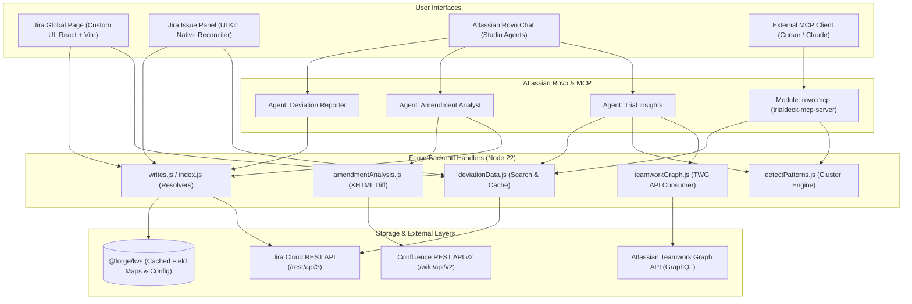

# TrialDeck Architecture & Design

This document details the architectural design and system workflows of **TrialDeck (Clinical Trial Operations Hub)**.

---

## 1. High-Level Architecture Diagram

---

## 2. Core Architectural Pillars

### Pillar 1: Human-in-the-Loop AI Governance
- **Strict Approval Primitives:** All Rovo agents (`deviation-reporter`, `amendment-analyst`) operate in read-only analysis mode until the user explicitly replies `APPROVE` in the conversation.
- **Traceable Grounding:** AI report drafts only include facts returned by Jira issue fields and comments, explicitly citing the source field or comment for every statement.
- **Visible Sign-Off:** The Jira issue panel displays an interactive **Regulatory Deviation Report** card where investigators can formally `Approve Report` or `Request Changes`.

### Pillar 2: Resilient Field Resolution & Dynamic Project Scope
- Rather than hardcoding custom field IDs (which differ on every Jira site), TrialDeck includes a case-insensitive alias matcher (`lib/fields.js`) that recognizes lower-case, title-case, and alternative phrasing (e.g., `Site`, `site`, `trial site`).
- If custom fields are not present, the app gracefully degrades without throwing fatal errors.
- Automatically discovers all projects containing the `Protocol Deviation` work type, allowing single-project or multi-project operations.

### Pillar 3: Model Context Protocol (MCP) Integration
- Exposes read-only clinical operations tools directly to external developer AI assistants (Cursor, Claude Desktop) and internal agents via Atlassian's managed MCP server infrastructure.
- Zero risk of external agents modifying Jira records, as all MCP tools are strictly read-only.
